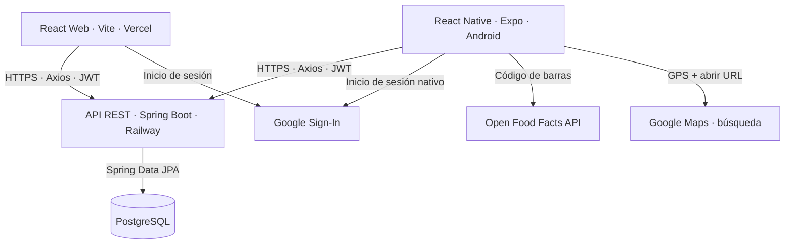

# Manka 🍳

### Cocina con lo que tienes

**Manka** es una aplicación de recomendaciones de recetas disponible en **Web** y **Android**. Ayuda a responder una pregunta cotidiana: **«¿Qué puedo cocinar con los ingredientes que tengo y el tiempo disponible?»**.

El proyecto combina una API REST en **Spring Boot**, una base de datos **PostgreSQL**, una aplicación **React + Vite** y una aplicación **React Native + Expo**. Las recomendaciones se generan en el backend mediante un motor de puntuación que considera los ingredientes disponibles, el tiempo, la variedad, la repetición y la popularidad de las recetas.

> Proyecto desarrollado para **CS2031 — Desarrollo Basado en Plataformas (DBP), 2026-2**.

## 🌐 Enlaces del proyecto

| Recurso | Enlace |
|---|---|
| **Aplicación Web** | [Abrir Manka en Vercel](https://manka-frontend.vercel.app/) |
| **Aplicación móvil Android (APK Preview proporcionada)** | [Ver compilación en Expo](https://expo.dev/accounts/fran-li/projects/manka-mobile/builds/3b04cb3e-16c4-4991-a4cc-26ab337d6ff6) |
| **Repositorio Backend** | [github.com/fran-li/manka-backend](https://github.com/fran-li/manka-backend) |
| **Repositorio Frontend (Web + Mobile)** | [github.com/fran-li/manka-frontend](https://github.com/fran-li/manka-frontend) |
| **API desplegada** | [manka-backend-production.up.railway.app](https://manka-backend-production.up.railway.app) |


## 🎯 Problema y solución

Al momento de cocinar, muchas personas disponen de ingredientes, pero no saben qué preparar o cuánto tiempo les tomará. Manka permite registrar una despensa, explorar un recetario y obtener recomendaciones personalizadas considerando tanto los ingredientes disponibles como el tiempo de preparación.

Las aplicaciones Web y Mobile **consumen la misma API de Spring Boot**. Los datos de usuarios, recetas, favoritos, historial y despensa pertenecen al backend; la app no utiliza catálogos de recetas simulados para sus funciones principales.

## ✨ Funcionalidades

| Funcionalidad | Web | Mobile |
|---|:---:|:---:|
| Registro e inicio de sesión con correo y contraseña | ✅ | ✅ |
| Inicio de sesión con Google | ✅ | ✅ |
| Inicio y navegación por secciones | ✅ | ✅ |
| Búsqueda y exploración de recetas | ✅ | ✅ |
| Detalle de receta, ingredientes e instrucciones | ✅ | ✅ |
| Recomendaciones según ingredientes y tiempo disponible | ✅ | ✅ |
| Despensa personal editable | ✅ | ✅ |
| Guardar y quitar recetas favoritas | ✅ | ✅ |
| Registrar platos cocinados e historial | ✅ | ✅ |
| Administración de usuarios y roles (ADMIN) | ✅ | ✅ |
| Paginación de recetas y recomendaciones desde la API | ✅ | ✅ |
| Paginación avanzada: tamaños de página y parámetros en URL | ✅ | — |
| Escaneo de códigos de barras con la cámara | — | ✅ |
| Identificación de productos mediante Open Food Facts | — | ✅ |
| GPS para buscar mercados en Google Maps | — | ✅ |

### Manka Web

Desarrollada con React, TypeScript, Vite, Tailwind CSS y estilos propios. Incluye rutas protegidas, filtros, búsqueda con debounce, sugerencias tolerantes a errores tipográficos mediante **Fuse.js** en el selector de ingredientes, navegación al detalle de recetas y paginación con números, tamaños configurables e información de resultados. En **Explorar**, se puede elegir entre **10, 25, 50 o 100** recetas por página; en **¿Qué cocino?**, entre **10 o 20** recomendaciones, conforme al límite del backend.

### Manka Mobile

Desarrollada con React Native, Expo y Expo Router. También utiliza **Fuse.js** como apoyo a la selección de ingredientes. Incorpora un menú lateral (*Drawer*), navegación a detalles de recetas y autenticación nativa con Google. Además incorpora dos sensores del dispositivo:

1. **Cámara:** escanea códigos EAN/UPC con `expo-camera`, consulta `GET https://world.openfoodfacts.org/api/v3/product/{codigo}` y muestra información del producto. Antes de incorporarlo a la despensa, el usuario selecciona y confirma uno o varios ingredientes equivalentes del catálogo de **Manka**. El producto externo no se guarda directamente como una receta ni crea ingredientes automáticamente en la base de datos.
2. **Ubicación/GPS:** obtiene la posición con `expo-location` y abre una búsqueda de mercados, supermercados o abarrotes en **Google Maps** mediante un enlace de búsqueda. **No utiliza Google Places API ni requiere una clave de Maps**.

Las dos funciones solicitan permisos en el momento de uso y contemplan alternativas: ingresar manualmente un código de barras, buscar ingredientes sin escaneo o buscar mercados escribiendo un distrito/ciudad.

## 🏗️ Arquitectura



**Separación de responsabilidades:**

- **Frontend Web / Mobile:** interfaces, navegación, estados de carga, validaciones y peticiones HTTP.
- **Backend:** autenticación, autorización, reglas de negocio, catálogo, despensa, favoritos, historial y motor de recomendaciones.
- **PostgreSQL:** persistencia de usuarios, recetas, ingredientes, relaciones y sesiones de renovación.
- **Servicios externos:** Google para identidad, Open Food Facts para información de productos y Google Maps para presentar búsquedas geográficas.

### Tecnologías principales

| Capa | Tecnologías verificadas |
|---|---|
| Backend | Java 21, Spring Boot 4.0.0, Spring Web, Spring Security, Spring Data JPA, Bean Validation, Maven |
| Persistencia | PostgreSQL 17 (entorno local del `compose.yaml`), Hibernate/JPA |
| Seguridad | JWT firmado con RSA, refresh tokens, BCrypt, roles USER y ADMIN, Google ID Token |
| Web | React 19, TypeScript 6, Vite 8, React Router, Axios, Tailwind CSS 4, Fuse.js |
| Mobile | React Native 0.88, Expo SDK 58, Expo Router, Drawer, Axios, Expo SecureStore |
| Sensores Mobile | `expo-camera`, `expo-location` |
| Deploy | Railway (API y base de datos), Vercel (Web), Expo EAS (Android) |
| Pruebas backend | JUnit, Spring Boot Test, Spring Security Test y Testcontainers |

## 🗃️ Origen del recetario y limpieza de la base de datos

### Fuente de los datos

El catálogo inicial de recetas de Manka se construyó a partir del dataset público **[RecetasDeLaAbuel@ de SomosNLP](https://huggingface.co/datasets/somosnlp/RecetasDeLaAbuela)**, alojado en Hugging Face. Para preparar los datos se utilizó el archivo **[`main.csv`](https://huggingface.co/datasets/somosnlp/RecetasDeLaAbuela/blob/main/main.csv)**, que contiene información como nombre de la receta, ingredientes, pasos de preparación, duración, categoría y dificultad. **El dataset pertenece a sus autores originales; Manka lo utiliza como fuente de datos y realiza una adaptación propia para su modelo relacional y sus funcionalidades.**

El CSV **no se consume directamente desde los frontends ni se consulta en Hugging Face durante cada búsqueda**. Se procesó previamente para generar datos compatibles con **PostgreSQL**, desde donde la API REST de Spring Boot sirve el recetario a Web y Mobile.

### Proceso de depuración, transformación e importación

La importación no consistió en copiar el CSV directamente a la base de datos. Fue necesario desarrollar un proceso de **extracción, transformación y carga (ETL)** y corregir varios problemas encontrados durante las pruebas:

1. **Lectura y estructuración de recetas.** Se interpretaron los campos del CSV y se separaron las recetas de sus ingredientes para llevarlos a tablas relacionadas (`dishes`, `ingredients` y sus relaciones). El campo `Ingredientes` podía contener listas serializadas o texto libre, por lo que se requirió un tratamiento diferente según el formato. **No se inventaron ingredientes a partir de `Pasos`**.
2. **Normalización y eliminación de variantes redundantes.** Había nombres equivalentes escritos de formas distintas, por ejemplo, `jitomate`/`tomates` → **Tomate** y `papas`/`patatas` → **Papa**. Se unificaron identificadores cuando la equivalencia era suficientemente clara y se conservaron alias para facilitar las búsquedas. En una etapa documentada de la limpieza se consolidaron **917 variantes de ingredientes** en identificadores genéricos; los casos ambiguos se reservaron para revisión en lugar de fusionarse indiscriminadamente.
3. **Conservación de las cantidades originales.** Algunas transformaciones iniciales podían alterar o simplificar unidades y descripciones de ingredientes. Para evitar perder información, se preservó el texto original del CSV —por ejemplo, **«1 libra» debía seguir siendo «1 libra», no «1 unidad»**—. El proceso documentó **178 445 líneas originales de ingredientes**, destinadas a mantener la fidelidad del detalle de cada receta.
4. **Tratamiento de datos incompletos o inconsistentes.** Se normalizaron formatos, se revisaron entradas vacías o ruidosas y se aplicaron valores estimados cuando faltaban datos como duración o dificultad. También se contempló la categoría **«Otros»** para evitar etiquetar automáticamente recetas ambiguas como vegetarianas.
5. **Corrección de incompatibilidades con PostgreSQL.** Durante la importación surgieron errores por representar campos booleanos mediante `0` y `1` en vez de `true` y `false`, así como conflictos asociados a registros o relaciones duplicadas. Se ajustó el SQL generado y se verificó la correspondencia entre IDs, recetas e ingredientes.
6. **Carga controlada y verificación.** Se evitó ejecutar repetidamente el script de carga sobre una base ya poblada, porque eso podía provocar errores de claves duplicadas. Después de la carga inicial se utilizó la configuración **`spring.sql.init.mode=never`**; para actualizar datos existentes, la estrategia correcta es una migración controlada y con respaldo previo, no reinsertar todo el catálogo.

**Resultado:** el proceso permitió incorporar **20 236 recetas** al catálogo utilizado por Manka y construir relaciones de ingredientes aprovechables por el buscador, la despensa y el motor de recomendaciones. Las cifras de ingredientes únicos variaron entre iteraciones de normalización; por ello, no se deben confundir los resultados intermedios del ETL con los conteos de una instalación concreta de PostgreSQL.

> **Créditos y procedencia:** [SomosNLP — RecetasDeLaAbuel@ (Hugging Face)](https://huggingface.co/datasets/somosnlp/RecetasDeLaAbuela). La fuente original y las transformaciones realizadas para Manka son procesos distintos: la autoría del dataset corresponde a sus creadores y la preparación para el esquema de esta aplicación corresponde al trabajo del proyecto.

## 🧠 Motor de recomendaciones

El motor está implementado **en Spring Boot**, no en el frontend, y combina varios criterios mediante puntuaciones ponderadas. Los pesos configurados en `application.properties` son:

| Criterio | Peso | Función |
|---|---:|---|
| Cobertura de ingredientes | **45 %** | Favorece platos cuyos ingredientes requeridos coinciden con los disponibles |
| Tiempo de preparación | **20 %** | Considera el tiempo declarado por el usuario |
| Variedad de proteínas | **10 %** | Favorece variedad frente al historial reciente |
| Repetición | **20 %** | Penaliza platos preparados recientemente |
| Popularidad | **5 %** | Incorpora la popularidad registrada de las recetas |
| **Total** | **100 %** | Puntuación final ponderada |

**Proceso:** el backend obtiene los ingredientes elegidos o, si no se especifican, los de la despensa; identifica recetas candidatas, calcula los criterios de cada receta, ordena el resultado por puntuación y devuelve la página solicitada. El resultado también informa ingredientes coincidentes y faltantes. El sistema es **un ranking basado en reglas y puntuaciones**, no un modelo de inteligencia artificial generativa.

La paginación del catálogo utiliza Spring Data `Page`; en recomendaciones se ordenan los candidatos elegibles y se construye la página de resultados con `PageImpl`. La API conserva metadatos como `content`, `number`, `totalElements`, `totalPages`, `first` y `last`.

## 🔐 Autenticación y autorización

Manka admite registro y login tradicional, además de inicio de sesión con Google. Spring Boot valida credenciales o el ID token de Google y emite **access token** y **refresh token**. Los clientes Axios adjuntan `Authorization: Bearer <token>` y utilizan interceptores para gestionar errores de autenticación y renovación de tokens.

- **Web:** almacena actualmente ambos tokens en `localStorage`.
- **Mobile:** utiliza `expo-secure-store` y una caché de sesión en memoria.
- **Backend:** utiliza Spring Security, JWT firmados con RSA y control de roles. Las rutas `/admin/**` requieren `ADMIN`; las demás rutas protegidas requieren autenticación, excepto los endpoints públicos de registro y login.

> **Consideración de seguridad:** el almacenamiento Web en `localStorage` es el comportamiento real del código actual; no se ha migrado a cookies HttpOnly. No incluyas contraseñas, claves RSA, secretos OAuth ni credenciales reales en GitHub o en variables públicas del frontend.

## 📡 API REST — endpoints principales

**Base URL de producción:** `https://manka-backend-production.up.railway.app`

| Método | Ruta | Descripción |
|---|---|---|
| `POST` | `/users/register` | Registro de usuario |
| `POST` | `/auth/login` | Login con correo y contraseña |
| `POST` | `/auth/google` | Login con ID token de Google |
| `POST` | `/auth/refresh` | Renovación de access y refresh tokens |
| `POST` | `/auth/logout` | Revocación del refresh token recibido |
| `GET` | `/users/me` | Perfil del usuario autenticado |
| `PATCH` | `/users/me` | Actualización de perfil |
| `GET` | `/ingredients` | Búsqueda de ingredientes |
| `GET` | `/ingredients/page` | Ingredientes paginados |
| `GET` | `/dishes` | Búsqueda de recetas |
| `GET` | `/dishes/page` | Recetas paginadas, búsqueda y filtro de tiempo |
| `GET` | `/dishes/{id}` | Detalle de una receta |
| `POST` | `/recommendations` | Ranking personalizado y paginado |
| `GET` | `/pantry` | Consultar la despensa personal |
| `PUT` | `/pantry` | Reemplazar la selección de ingredientes de la despensa |
| `GET` | `/favorites` | Consultar favoritos |
| `POST` | `/favorites/{dishId}` | Agregar receta a favoritos |
| `DELETE` | `/favorites/{dishId}` | Quitar receta de favoritos |
| `GET` | `/history` | Consultar historial de cocina |
| `POST` | `/history` | Registrar receta cocinada |
| `GET` | `/admin/users` | Listar usuarios (ADMIN) |
| `PATCH` | `/admin/users/{id}/roles` | Actualizar roles (ADMIN) |
| `DELETE` | `/admin/users/{id}` | Eliminar usuario permitido (ADMIN) |

Salvo registro y autenticación, los endpoints requieren un JWT válido. En consultas paginadas, `page` empieza desde **0**. El catálogo de platos permite tamaños de hasta **100**; recomendaciones valida `limit` de **1 a 20**.

### Ejemplo de solicitud de recomendaciones

```http
POST /recommendations
Authorization: Bearer ACCESS_TOKEN
Content-Type: application/json
```

```json
{
  "ingredientIds": [1, 2, 3],
  "availableMinutes": 30,
  "page": 0,
  "limit": 10
}
```

Los identificadores son ilustrativos y deben existir en la base de datos. Si `ingredientIds` se omite o está vacío, el servicio puede utilizar los ingredientes guardados en la despensa.

## 📁 Organización de repositorios

Los componentes están separados en **dos repositorios GitHub**:

```text
manka-backend/
├── pom.xml
├── compose.yaml
├── mvnw / mvnw.cmd
└── src/
    ├── main/java/pe/edu/utec/manka/
    │   ├── config/
    │   ├── controller/
    │   ├── dto/
    │   ├── entity/
    │   ├── event/ y listener/
    │   ├── recommendation/scorer/
    │   ├── repository/
    │   └── service/
    └── test/

manka-frontend/
├── web/
│   ├── src/api/
│   ├── src/auth/
│   ├── src/components/
│   ├── src/layout/
│   ├── src/pages/
│   ├── vite.config.ts
│   └── vercel.json
└── mobile/
    ├── app/                 # Rutas Expo Router (auth y drawer)
    ├── src/api/
    ├── src/auth/
    ├── src/components/
    ├── src/screens/
    ├── src/services/        # Open Food Facts
    ├── .eas/workflows/
    ├── app.json
    └── eas.json
```

## 🚀 Ejecución local

### Requisitos

- **JDK 21** y Git.
- **Docker Desktop**, para PostgreSQL (o una instancia PostgreSQL propia).
- **Node.js y npm** compatibles con las versiones del proyecto.
- Android con una **Expo Development Build** para probar las funciones nativas de Google, cámara y ubicación.
- Claves de Google OAuth correctamente configuradas si se va a probar el login con Google.

### 1. Backend (Spring Boot)

```bash
git clone https://github.com/fran-li/manka-backend.git
cd manka-backend
docker compose up -d postgres mailpit
```

El `compose.yaml` expone PostgreSQL en **`localhost:5433`** (base `manka`, usuario `postgres`) y Mailpit en **`localhost:8025`** para visualizar correos de desarrollo. La contraseña de Docker Compose es un valor **solo para desarrollo**.

El backend espera las claves RSA `app.key` y `app.pub` dentro de `src/main/resources/` si no se configuran rutas alternativas mediante variables de entorno. Puedes generar claves de desarrollo con OpenSSL:

```bash
openssl genpkey -algorithm RSA -pkeyopt rsa_keygen_bits:2048 -out src/main/resources/app.key
openssl pkey -in src/main/resources/app.key -pubout -out src/main/resources/app.pub
```

Esos archivos están excluidos por `.gitignore`. Para ejecutar con la base del `compose.yaml`, configura la contraseña local y arranca el servidor:

```bash
export DB_PASSWORD=postgres
./mvnw spring-boot:run
```

En Windows, también puedes utilizar `mvnw.cmd` desde una terminal compatible. El backend arranca en **`http://localhost:8083`** por defecto. Las tablas pueden crearse/actualizarse según `JPA_DDL_AUTO`, pero **el ZIP del backend no incluye un `data.sql` de producción**: necesitarás cargar datos del catálogo por separado para probar recetas reales. El `data.sql` existente bajo `src/test/resources/` pertenece a las pruebas.

Variables de configuración relevantes:

| Variable | Propósito / valor local predeterminado |
|---|---|
| `DB_URL` | `jdbc:postgresql://localhost:5433/manka` |
| `DB_USERNAME` | `postgres` |
| `DB_PASSWORD` | Sin valor predeterminado en `application.properties`; configurar localmente |
| `PORT` | `8083` |
| `JPA_DDL_AUTO` | `update` (configurable según entorno) |
| `SQL_INIT_MODE` | `never` |
| `JWT_PRIVATE_KEY`, `JWT_PUBLIC_KEY` | Rutas de recursos RSA; por defecto `classpath:app.key` y `classpath:app.pub` |
| `JWT_ACCESS_TOKEN_SECONDS` | `36000` |
| `JWT_REFRESH_TOKEN_SECONDS` | `604800` |
| `CORS_ALLOWED_ORIGINS` | Orígenes Web permitidos, separados por comas |
| `MAIL_ENABLED` | `false` por defecto |
| `MAIL_HOST`, `MAIL_PORT` | Configuración SMTP / Mailpit de desarrollo |
| `MANKA_ADMIN_EMAIL`, `MANKA_ADMIN_PASSWORD` | Inicialización opcional de cuenta administradora |

No reutilices contraseñas de ejemplo en producción. Para correr la batería de pruebas de integración se requiere Docker por el uso de Testcontainers:

```bash
./mvnw test
```

### 2. Frontend Web (React + Vite)

```bash
git clone https://github.com/fran-li/manka-frontend.git
cd manka-frontend/web
npm install
```

Crea `web/.env.local` con los valores necesarios para desarrollo:

```dotenv
VITE_API_URL=/api
VITE_BACKEND_URL=http://localhost:8083
```

`vite.config.ts` redirige `/api` al backend local y elimina el prefijo `/api` antes de enviar la solicitud. El cliente Web usa Axios y añade el JWT automáticamente. El botón Google de la versión adjunta contiene un **Web Client ID** configurado en `src/components/GoogleSignInButton.tsx`; para utilizar otro proyecto OAuth, revísalo junto con la configuración del proveedor. El archivo `.env.example` también documenta `VITE_GOOGLE_CLIENT_ID`, pero **el componente actual no lee esa variable**.

```bash
npm run dev
npm run build
```

Vite sirve normalmente el entorno local en **http://localhost:5173**.

### 3. Frontend Mobile (React Native + Expo)

```bash
cd ../mobile
npm install
```

Crea `mobile/.env` con la API y el cliente Web de Google configurado para la autenticación nativa:

```dotenv
EXPO_PUBLIC_API_URL=https://manka-backend-production.up.railway.app
EXPO_PUBLIC_GOOGLE_WEB_CLIENT_ID=TU_GOOGLE_WEB_CLIENT_ID
```

Las variables `EXPO_PUBLIC_` se incorporan a la aplicación; **no coloques secretos en ellas**. El login nativo con Google también requiere un OAuth Client de Android asociado al package `pe.manka.mobile` y a la huella SHA-1 de la firma correspondiente.

Para verificar tipos e iniciar Metro en una Development Build:

```bash
npx tsc --noEmit
npx expo start --dev-client -c
```

Instala la **Development Build** en Android y escanea el QR de Metro. **Expo Go no sirve para probar el Google Sign-In nativo configurado en este proyecto**. Si agregas o cambias módulos nativos como `expo-camera` o `expo-location`, debes generar una nueva compilación:

```bash
eas build --profile development --platform android
```

## ☁️ Despliegue y actualizaciones

| Servicio | Componente | Configuración principal |
|---|---|---|
| **Railway** | API Spring Boot + PostgreSQL administrado | Variables de base de datos, JWT, CORS y servidor HTTPS |
| **Vercel** | Frontend Web | Repositorio `manka-frontend`, **Root Directory: `web`** |
| **Expo EAS** | App Android | Repositorio `manka-frontend`, **Base Directory: `mobile`** |

**Web en Vercel.** La SPA tiene una regla de rewrite hacia `index.html`. Para producción, el frontend utiliza la URL del backend de Railway mediante `VITE_API_URL` (por ejemplo, `https://manka-backend-production.up.railway.app`). La API debe permitir el origen del sitio Web mediante `CORS_ALLOWED_ORIGINS`. La regla actual de `web/vercel.json` **no implementa un proxy de API en producción**.

**Mobile en Expo.** `mobile/eas.json` define perfiles `development`, `preview` (APK Android) y `production`. La aplicación está configurada con el canal `preview`, `expo-updates` y política de runtime `appVersion`. El workflow `mobile/.eas/workflows/update-preview.yml` intenta publicar una actualización OTA para Android cuando hay un push a `main` con cambios en `mobile/**`.

```bash
cd mobile
eas build --profile preview --platform android
```

**Importante:** una actualización OTA puede entregar cambios JavaScript compatibles, pero **no añade módulos nativos ausentes en una APK anterior**. Después de incorporar cámara/GPS, es necesario instalar una Preview Build nueva que contenga esos módulos. Las variables de entorno de Expo EAS deben configurarse también para el entorno `preview`.

## 🧪 Pruebas y comprobaciones

```bash
# Backend (desde manka-backend)
./mvnw test

# Web (desde manka-frontend/web)
npm run build

# Mobile (desde manka-frontend/mobile)
npx tsc --noEmit
```

Para una demostración funcional se recomienda probar: registro/login y Google, consulta de recetas, paginación, recomendaciones con diferentes ingredientes y tiempos, despensa, favoritos, historial, administración con cuenta autorizada, escaneo de un código de barras y búsqueda de mercados con GPS o zona manual.

## 👥 Equipo 


| Integrante | Codigo | Participación individual |
|---|---|---:|
| **[Francisco Jose Lira Francia ]** | **[201910540]** | **[100 %]** 
| **[Juan Carlos Sebastian Lescano Garamendi ]** | **[202510447]** | **[100 %]** 


## 📌 Alcance y consideraciones

- Manka se apoya en su **API REST propia** para las funciones principales de cocina y administración; Open Food Facts es un complemento para identificar productos envasados.
- La información de Open Food Facts depende de la cobertura y calidad de la base de datos comunitaria. Si un producto no está registrado, se ofrece ingreso manual.
- La búsqueda de mercados **abre Google Maps**; no consulta ni almacena un directorio de establecimientos en PostgreSQL.
- El acceso GPS se solicita al utilizar la búsqueda; el flujo actual no guarda las coordenadas del usuario en la base de datos de Manka.
- Las funcionalidades de notificaciones por correo están previstas en el backend mediante listeners y servicio SMTP, pero su envío real depende de `MAIL_ENABLED` y de configurar un servidor de correo.
- La disponibilidad de los despliegues, los datos cargados y las builds de Expo puede cambiar; para una presentación conviene comprobar los enlaces y preparar usuarios de demostración antes del evento.

---

**Manka — Cocina con lo que tienes.**
